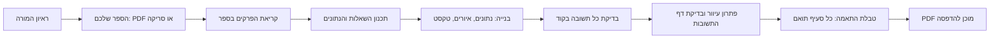

<div align="center">

<pre>
   _______
  /       \      ____                             _      ___
 /  \ | /  \    |  _ \    ___     ___    ___     / \    |_ _|
|  -- O --  |   | |_) |  / _ \   / _ \  / _ \   / _ \    | |
 \  / | \  /    |  _ &lt;  | (_) | |  __/ |  __/  / ___ \   | |
  \_______/     |_| \_\  \___/   \___|  \___| /_/   \_\ |___|
</pre>

# Rosen Exam Builder

**A Claude Code skill that turns your physics textbook (Adi Rosen's books are built in) or your own class material into print-ready Hebrew exams, answer sheets and review exams.**


</div>

<div dir="rtl">

## מה צריך לעשות? שלושה צעדים

1. **מתקינים פעם אחת.** פותחים את Claude Code בתיקייה של הפרויקט שלכם ומדביקים את הודעת ההתקנה (בהמשך העמוד).
   ההתקנה גם יוצרת בפרויקט תיקייה בשם **ספרים**.
2. **שמים את הספר בתיקייה ספרים.** בשם הקובץ כותבים את המילה **פיזיקה**, למשל: **פיזיקה - אופטיקה**.
   אפשר ספר של עדי רוזן, ספר אחר או חומר שלכם (סיכומים, דפי עבודה), כקובץ PDF, סריקות או צילומים.
3. **מבקשים מבחן.** כותבים למשל "תבנה לי מבחן באופטיקה לכיתה י׳", עונים על כמה שאלות קצרות, ומקבלים קובצי PDF
   מוכנים להדפסה.

כך נראית תיקיית הפרויקט:

</div>

```text
📁 הפרויקט שלכם            ← כאן פותחים את Claude Code
├── 📁 ספרים               ← כאן שמים את הספר
│   ├── 📄 פיזיקה - אופטיקה.pdf
│   └── 📄 פיזיקה - מכניקה כרך א.pdf
├── 📁 .claude              ← הסקיל (נוצר בהתקנה)
└── 📁 אופטיקה              ← המבחנים נשמרים כאן
```

<div dir="rtl">

## מה זה עושה

כותבים ל-Claude Code "תבנה לי מבחן באופטיקה לכיתה י׳", עונים על כמה שאלות קצרות, ומקבלים מבחן בפיזיקה מעוצב
להדפסה, מבוסס על הפרקים בספר שלכם, עם איורים מדויקים, דף תשובות מלא ואם רוצים גם מבחן חזרה או מועד ב׳.
הספרים של עדי רוזן מוכרים לסקיל מראש, ואפשר לבנות מבחן גם מכל ספר פיזיקה אחר או מחומר שלכם: סיכומים, מצגות,
דפי עבודה ומבחנים קודמים.
כל מספר בתשובות מחושב ונבדק בקוד, סוכן נפרד פותר את המבחן "עיוור", וסוכן נוסף בודק את דף התשובות, לפני שמשהו מגיע אליכם.

| מקבלים | תיאור |
|---|---|
| 📄 מבחן | A4, עברית מימין לשמאל, כותרת עם שם/כיתה/תאריך, תיבת הנחיות ונוסחאות, כל שאלה בעמוד חדש |
| ✅ דף תשובות | פתרון מלא לכל סעיף, חישובים, תוצאות מודגשות וסרטוטים משלימים, והערה למורה על מקור כל שאלה בספר |
| 🔁 מבחן חזרה | אותם נושאים ואותה רמה, עם הקשרים ומספרים אחרים (לא רק מספרים מוחלפים) |
| 🛠️ תיקיית מקור | הנתונים, הבדיקות, האיורים והטקסט, כדי לשנות ולבנות מחדש בשנייה |

## איך זה עובד

</div>



<div dir="rtl">

הסקיל שואל, בשני סבבים קצרים:

1. מקצוע: אופטיקה, מכניקה או חשמל
2. כיתה ורמה: י׳, יא׳ או יב׳ (5 יח״ל)
3. משך המבחן: שעה, שעה וחצי או שעתיים
4. רמת קושי: קל, בינוני או ברמת בגרות
5. **הספר או החומר שלכם** (ספר של עדי רוזן, ספר אחר, סיכומים או דפי עבודה; PDF, סריקות או צילומים): אם יש כבר ספר בפרויקט הסקיל מציע אותו, ואם לא, אפשר לכתוב איפה הקובץ נמצא, או לשים אותו בתיקייה `ספרים/` שהסקיל פותח בפרויקט, והוא ימצא אותו לבד. כדאי שהמילה "פיזיקה" תופיע בשם הקובץ (למשל "פיזיקה - אופטיקה.pdf"), כך שהסקיל ימצא אותו בכל מקום בפרויקט
6. נושאים: לפי פרקי הספר או החומר שלכם
7. כמות שאלות, האם לבנות מבחן חזרה, והאם צריך דף תשובות

אפשר גם לבקש מבחן משאלות מסוימות בספר ("שאלות 3, 8 ו-10 מפרק א"): הנוסח נשמר, השאלות ממוספרות מחדש
והאיורים מסורטטים מחדש בצורה עקבית עם הנתונים.

## התקנה (בתוך הפרויקט)

הסקיל מותקן בתיקיית הפרויקט שלכם, ולא בהתקנה גלובלית. הדרך הקלה: להדביק ב-Claude Code, מתוך תיקיית הפרויקט:

</div>

```text
התקן בפרויקט הזה את הסקיל rosen-exam-builder: שכפל את https://github.com/roeea2/rosen-exam-builder
לתוך התיקייה .claude/skills/rosen-exam-builder של הפרויקט (לא בהתקנה גלובלית), צור בפרויקט תיקייה בשם ספרים,
ובדוק ש-Python 3.12+, Google Chrome ו-poppler מותקנים. אמור לי אם חסר משהו.
```

<div dir="rtl">

או מהטרמינל, מתוך תיקיית הפרויקט:

</div>

```bash
git clone https://github.com/roeea2/rosen-exam-builder.git .claude/skills/rosen-exam-builder
mkdir ספרים
```

<div dir="rtl">

אחר כך פותחים מחדש את Claude Code בתיקיית הפרויקט. מדריך של עמוד אחד להדפסה נמצא ב-[docs/rosen-exam-builder-guide.pdf](docs/rosen-exam-builder-guide.pdf).

## שימוש

</div>

```text
תבנה לי מבחן באופטיקה לכיתה י׳ על פרקים א-ג, עם מבחן חזרה ודף תשובות
בוחן של שעה במכניקה על קינמטיקה, שתי שאלות ברמת בגרות
מבחן חוזר בחשמל משאלות 3, 8 ו-10 בפרק א, בלי דף תשובות
/rosen-exam-builder
```

<div dir="rtl">

רוצים לשנות משהו? פשוט אומרים: "שאלה 2 קשה מדי", "תחליף את ההקשר של שאלה 1", "המבחן צריך להיות שעה וחצי".
הסקיל מעדכן את הנתונים, בודק שוב ובונה מחדש.

## בקרת איכות

* **נתונים אחד, אמת אחת:** השאלות, האיורים ודף התשובות נבנים מאותו קובץ נתונים, כך שהם לא יכולים לסתור זה את זה.
* **בדיקה בקוד:** כל מספר שמופיע בדף התשובות מחושב מחדש ונבדק. הבנייה עצמה מריצה את הבדיקות ונעצרת אם אחת נכשלת, כך שלא נוצר PDF עם תשובה שגויה.
* **פתרון עיוור:** סוכן נפרד פותר את המבחן מתוך ה-PDF בלבד, ומדווח על ניסוחים דו-משמעיים, נתונים לא מציאותיים וטעויות.
* **בדיקת דף התשובות:** סוכן נוסף מקבל את המבחן ואת דף התשובות (בלי קוד המקור), פותר כל סעיף בעצמו ובודק תשובה, יחידות, הסבר וסרטוט.
* **טבלת התאמה:** שורה לכל סעיף: הפתרון העיוור מול דף התשובות. שום דבר לא נמסר עד שכל השורות תואמות.
* **עברית נכונה:** סורק מיוחד מאתר מלכודות של כתיבה מימין לשמאל, כמו נקודה שנצמדת למספר והופכת את "30°." ל-".30°".
* **בדיקה חזותית:** כל עמוד נבדק כתמונה: תוויות שמתנגשות, איור שנפרד מהטקסט שלו, עמוד כמעט ריק.

## דרישות

Python 3.12 ומעלה · Google Chrome או Chromium (להדפסת PDF) · poppler (`pdftoppm`, `pdftotext`, `pdfinfo`) ·
Pillow (אופציונלי) · חיבור לאינטרנט בזמן הבנייה (הגופנים Heebo ו-STIX נטענים מ-Google Fonts).

## ספרים, חומרים וזכויות יוצרים

אף ספר לא כלול במאגר, והסקיל לא מוריד ספרים מהאינטרנט: ספרים מוגנים בזכויות יוצרים, וכל מורה עובד מהעותק שלו.
לספרים של עדי רוזן (מחלקה להוראת המדעים, מכון ויצמן) יש בסקיל מפת פרקים מוכנה. לכל ספר או חומר אחר הסקיל בונה
את המפה מתוכן העניינים של הקובץ. הקבצים נשמרים בתיקייה `ספרים/` בפרויקט (מחוץ ל-git), כדי שיימצאו גם בפעם הבאה.
אין לכם ספר? אפשר לבנות מבחן גם בלי, לפי מפת הפרקים או תוכנית הבגרות, רק בלי הפניות לעמודים ולתרגילים.

## מבנה המאגר

</div>

```text
SKILL.md                     תהליך העבודה שהסקיל מבצע
scripts/examkit.py           עימוד, כותרת, תיבות הנחיות ונוסחאות, הדפסה ל-PDF
scripts/svgkit.py            איורים: קרניים, זוויות, מראות, נורות, עין, רשת משבצות, גרפים של תנועה
scripts/new_exam.py          יוצר תיקיית מבחן חדשה מהתבניות
scripts/find_books.py        מאתר את קובצי הספרים בפרויקט
scripts/render_pages.py      מציג עמודים מהספר ומהמבחן כתמונות
scripts/rtl_scan.py          מאתר בעיות תצוגה מימין לשמאל
templates/                   data.py, verify.py, figs.py, build.py
references/                  מפת הספרים, כללי כתיבת שאלות, כללי עימוד, הפתרון העיוור ובדיקת דף התשובות
docs/                        מדריך התקנה ושימוש של עמוד אחד
```

## In English

Rosen Exam Builder is a project-scoped [Claude Code](https://claude.com/claude-code) skill for physics teachers in
Israel. It interviews the teacher (subject, chapters, duration, difficulty, number of questions, review exam, answer
sheet), asks for the teacher's own book or material (Adi Rosen's books have a built-in chapter map; any other physics
textbook, notes or worksheets work too; no book is included),
reads the relevant chapters, writes original
bagrut-style questions with computed SVG figures, verifies every answer in code (the build stops on a failed
check), runs a blind solve and an answer-sheet audit with independent agents, requires every sub-part to match, and prints right-to-left Hebrew A4 PDFs with headless Chrome. Install it inside a project with
`git clone https://github.com/roeea2/rosen-exam-builder.git .claude/skills/rosen-exam-builder`.

## License

[MIT](LICENSE) © 2026 RoeeAI. The textbooks are not part of this repository; all rights in them belong to their owners.

<div align="center"><sub>Built with Claude Code by RoeeAI</sub></div>
