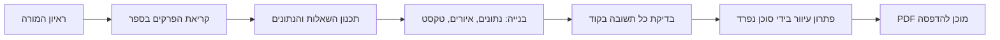

<div align="center">

<pre>
   _______
  /       \      ____                             _      ___
 /  \ | /  \    |  _ \    ___     ___    ___     / \    |_ _|
|  -- O --  |   | |_) |  / _ \   / _ \  / _ \   / _ \    | |
 \  / | \  /    |  _ &lt;  | (_) | |  __/ |  __/  / ___ \   | |
  \_______/     |_| \_\  \___/   \___|  \___| /_/   \_\ |___|
</pre>

# Rosen Exam Builder

**A Claude Code skill that turns Adi Rosen's physics textbooks into print-ready Hebrew exams, answer sheets and review exams.**


</div>

<div dir="rtl">

## מה זה עושה

כותבים ל-Claude Code "תבנה לי מבחן באופטיקה לכיתה י׳", עונים על כמה שאלות קצרות, ומקבלים מבחן בפיזיקה מעוצב
להדפסה, מבוסס על הפרקים בספר של עדי רוזן, עם איורים מדויקים, דף תשובות מלא ואם רוצים גם מבחן חזרה או מועד ב׳.
כל מספר בתשובות מחושב ונבדק בקוד, וסוכן נפרד פותר את המבחן "עיוור" לפני שהוא מגיע אליכם.

| מקבלים | תיאור |
|---|---|
| 📄 מבחן | A4, עברית מימין לשמאל, כותרת עם שם/כיתה/תאריך, תיבת הנחיות ונוסחאות, כל שאלה בעמוד חדש |
| ✅ דף תשובות | פתרון מלא לכל סעיף, חישובים, תוצאות מודגשות וסרטוטים משלימים, והערה למורה על מקור כל שאלה בספר |
| 🔁 מבחן חזרה | אותם נושאים ואותה רמה, עם הקשרים ומספרים אחרים (לא רק מספרים מוחלפים) |
| 🛠️ תיקיית מקור | הנתונים, הבדיקות, האיורים והטקסט, כדי לשנות ולבנות מחדש בשנייה |

## איך זה עובד

</div>



<div dir="rtl">

הסקיל שואל, בשני סבבים קצרים:

1. מקצוע: אופטיקה, מכניקה או חשמל
2. כיתה ורמה: י׳, יא׳ או יב׳ (5 יח״ל)
3. משך המבחן: שעה, שעה וחצי או שעתיים
4. רמת קושי: קל, בינוני או ברמת בגרות
5. נושאים: לפי פרקי הספר
6. כמות שאלות, האם לבנות מבחן חזרה, והאם צריך דף תשובות

אפשר גם לבקש מבחן משאלות מסוימות בספר ("שאלות 3, 8 ו-10 מפרק א"): הנוסח נשמר, השאלות ממוספרות מחדש
והאיורים מסורטטים מחדש בצורה עקבית עם הנתונים.

## התקנה (בתוך הפרויקט)

הסקיל מותקן בתיקיית הפרויקט שבה נמצאים הספרים, ולא בהתקנה גלובלית. הדרך הקלה: להדביק ב-Claude Code, מתוך תיקיית הפרויקט:

</div>

```text
התקן בפרויקט הזה את הסקיל rosen-exam-builder: שכפל את https://github.com/roeea2/rosen-exam-builder
לתוך התיקייה .claude/skills/rosen-exam-builder של הפרויקט (לא בהתקנה גלובלית), בדוק ש-Python 3.12+,
Google Chrome ו-poppler מותקנים, ואמור לי אם חסר משהו.
```

<div dir="rtl">

או מהטרמינל, מתוך תיקיית הפרויקט:

</div>

```bash
git clone https://github.com/roeea2/rosen-exam-builder.git .claude/skills/rosen-exam-builder
```

<div dir="rtl">

אחר כך פותחים מחדש את Claude Code בתיקיית הפרויקט. מדריך של עמוד אחד להדפסה נמצא ב-[docs/rosen-exam-builder-guide.pdf](docs/rosen-exam-builder-guide.pdf).

## שימוש

</div>

```text
תבנה לי מבחן באופטיקה לכיתה י׳ על פרקים א-ג, עם מבחן חזרה ודף תשובות
בוחן של שעה במכניקה על קינמטיקה, שתי שאלות ברמת בגרות
מבחן חוזר בחשמל משאלות 3, 8 ו-10 בפרק א, בלי דף תשובות
/rosen-exam-builder
```

<div dir="rtl">

רוצים לשנות משהו? פשוט אומרים: "שאלה 2 קשה מדי", "תחליף את ההקשר של שאלה 1", "המבחן צריך להיות שעה וחצי".
הסקיל מעדכן את הנתונים, בודק שוב ובונה מחדש.

## בקרת איכות

* **נתונים אחד, אמת אחת:** השאלות, האיורים ודף התשובות נבנים מאותו קובץ נתונים, כך שהם לא יכולים לסתור זה את זה.
* **בדיקה בקוד:** כל מספר שמופיע בדף התשובות מחושב מחדש ונבדק לפני כל בנייה.
* **פתרון עיוור:** סוכן נפרד פותר את המבחן מתוך ה-PDF בלבד, ומדווח על ניסוחים דו-משמעיים, נתונים לא מציאותיים וטעויות.
* **עברית נכונה:** סורק מיוחד מאתר מלכודות של כתיבה מימין לשמאל, כמו נקודה שנצמדת למספר והופכת את "30°." ל-".30°".
* **בדיקה חזותית:** כל עמוד נבדק כתמונה: תוויות שמתנגשות, איור שנפרד מהטקסט שלו, עמוד כמעט ריק.

## דרישות

Python 3.12 ומעלה · Google Chrome או Chromium (להדפסת PDF) · poppler (`pdftoppm`, `pdftotext`, `pdfinfo`) ·
Pillow (אופציונלי) · חיבור לאינטרנט בזמן הבנייה (הגופנים Heebo ו-STIX נטענים מ-Google Fonts).

## הספרים וזכויות יוצרים

הספרים של עדי רוזן (מחלקה להוראת המדעים, מכון ויצמן) מוגנים בזכויות יוצרים ואינם כלולים במאגר. צריך עותק משלכם
(PDF או סריקה של הפרקים) בתיקיית הפרויקט. הסקיל מאתר אותו לבד, או שואל איפה הוא.

## מבנה המאגר

</div>

```text
SKILL.md                     תהליך העבודה שהסקיל מבצע
scripts/examkit.py           עימוד, כותרת, תיבות הנחיות ונוסחאות, הדפסה ל-PDF
scripts/svgkit.py            איורים: קרניים, זוויות, מראות, נורות, עין, רשת משבצות, גרפים של תנועה
scripts/new_exam.py          יוצר תיקיית מבחן חדשה מהתבניות
scripts/find_books.py        מאתר את קובצי הספרים בפרויקט
scripts/render_pages.py      מציג עמודים מהספר ומהמבחן כתמונות
scripts/rtl_scan.py          מאתר בעיות תצוגה מימין לשמאל
templates/                   data.py, verify.py, figs.py, build.py
references/                  מפת הספרים, כללי כתיבת שאלות, כללי עימוד, תהליך הפתרון העיוור
docs/                        מדריך התקנה ושימוש של עמוד אחד
```

## In English

Rosen Exam Builder is a project-scoped [Claude Code](https://claude.com/claude-code) skill for physics teachers in
Israel. It interviews the teacher (subject, chapters, duration, difficulty, number of questions, review exam, answer
sheet), reads the relevant chapters of Adi Rosen's textbooks from the teacher's own copy, writes original
bagrut-style questions with computed SVG figures, verifies every answer in code, runs a blind solve with an
independent agent, and prints right-to-left Hebrew A4 PDFs with headless Chrome. Install it inside a project with
`git clone https://github.com/roeea2/rosen-exam-builder.git .claude/skills/rosen-exam-builder`.

## License

[MIT](LICENSE) © 2026 RoeeAI. The textbooks are not part of this repository; all rights in them belong to their owners.

<div align="center"><sub>Built with Claude Code by RoeeAI</sub></div>
